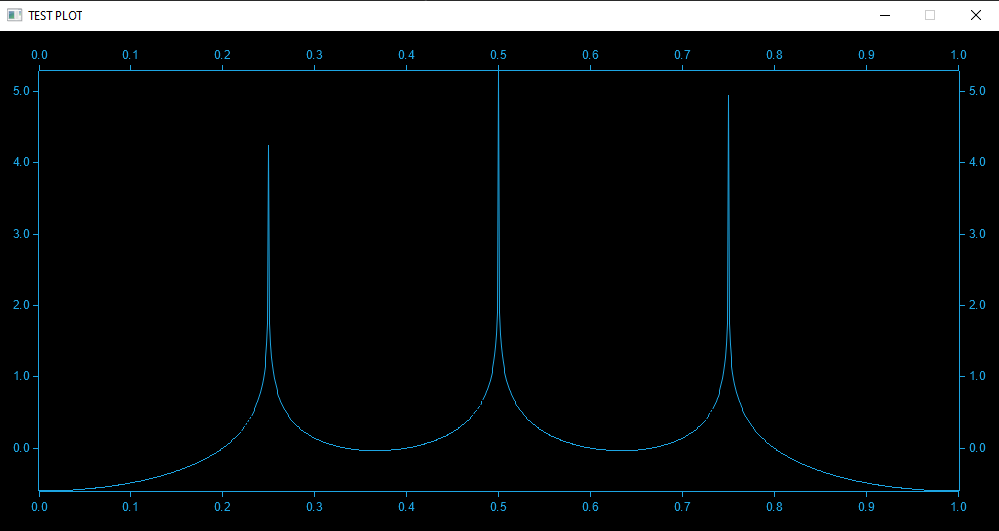

# Week 3 - Resonators

This week, I wrote an implementation for displaying Bode plots. The library works by taking a list of transfer function objects and generating a graph of the magnitude of the frequency response. The library then opens a window displaying the plot of the total frequency response of the transfer functions.

In addition, I started implementing the resonators themselves by creating a ConjPoleResonator struct that represents a set of conjugate poles in the Z-plane. The documentation for the library can be found [here][gp-resonator-docs].

[gp-resonator-docs]: https://amarantheum.github.io/GPResonatorLibrary 